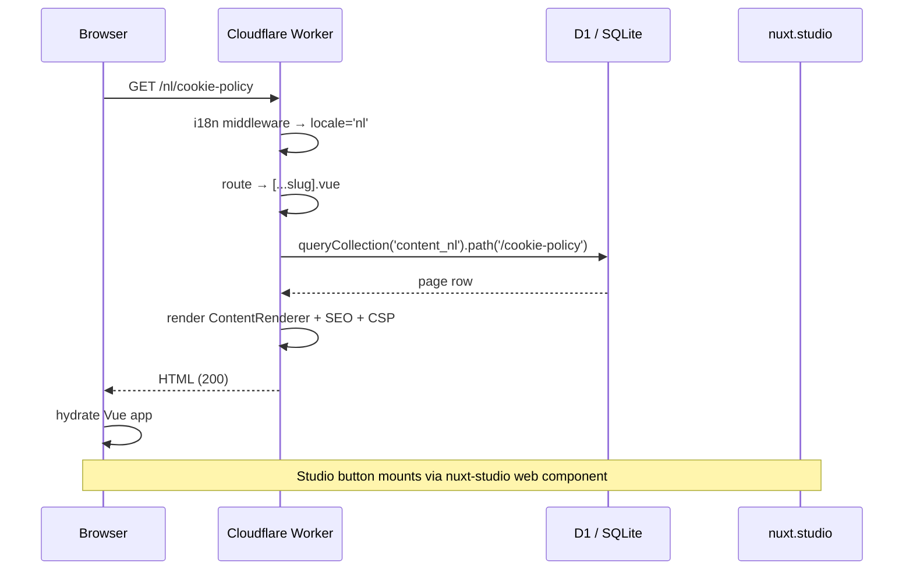
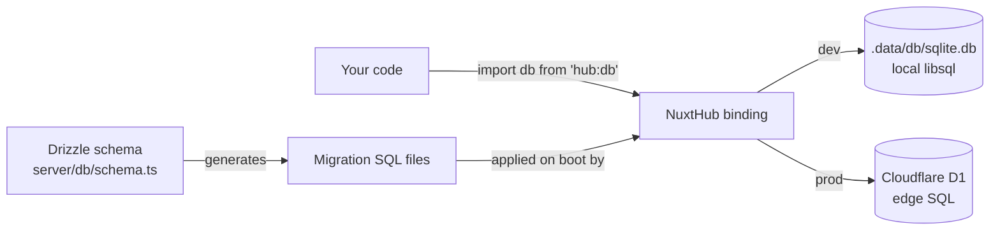

# WOTZ Nuxt Starter

A guided tour for new contributors

<div class="pt-12">
  <span class="px-2 py-1 rounded cursor-pointer text-sm" hover="bg-white bg-opacity-10">
    Press <kbd>space</kbd> to start →
  </span>
</div>

<!--
Welcome everyone. This deck is a guided tour of the WOTZ Nuxt 4 starter — what it is,
how it's put together, and the architectural decisions worth knowing before you start
shipping features in it.

Total: ~30 slides, aim for 25-30 minutes including questions.
-->

---

# Why this project exists

Most WOTZ projects share the same core needs:

- **Multilingual** — Dutch + French (the Belgian basics)
- **Editable content** — non-devs need to update copy without PRs
- **Authenticated dashboard** — for form submissions, user management
- **Cloudflare-deployed** — Workers + D1 + Wrangler
- **SEO-correct** — sitemap, hreflang, OG images, robots

Building all that from scratch every time is wasteful. This starter is the **pre-wired baseline** so each new project starts on day one with the boring parts already done.

<!--
Don't sell too hard. The point is: instead of debating architecture every project,
we have a known-good starting point and can focus on what's actually unique to each client.
-->

---

## layout: two-cols

# Stack at a glance

::left::

### Framework + UI

- **Nuxt 4** — Vue 3, file-based routing
- **Nuxt UI v4** — Tailwind v4 components
- **Nuxt Content v3** — markdown collections
- **Nuxt Studio** — visual editor

### Backend

- **Cloudflare Workers** (via NuxtHub)
- **Cloudflare D1** — production DB
- **Drizzle ORM** — type-safe SQL
- **nuxt-auth-utils** — sessions

::right::

### i18n + SEO

- **@nuxtjs/i18n v10**
- **@nuxtjs/seo** — sitemap, og, schema.org
- **canonicalId** translation linking

### Security

- **nuxt-security** — CSP, rate limiting
- **Cloudflare Turnstile** — bot protection

### Tooling

- **Oxlint + Oxfmt** — fast lint/format
- **Drizzle Kit** — migrations + Studio
- **TypeScript** strict mode

<!--
Don't read every bullet. Frame: "Here's the menu. Each of these has trade-offs and quirks
we'll go through one by one." Point out two: Nuxt 4 is the source layout where /app is the
src root (not /src), and NuxtHub is the layer that bundles Cloudflare deploy + D1 binding.
-->

---

# Project tour

```
.
├── app/                  ← Nuxt 4 source root (NOT src/)
│   ├── components/       ← C-prefixed custom components
│   ├── composables/      ← Auto-imported
│   ├── layouts/          ← default, dashboard, login
│   ├── middleware/       ← auth, superadmin
│   ├── pages/
│   │   ├── [...slug].vue ← catch-all, renders Nuxt Content
│   │   └── dashboard/    ← admin UI
│   └── plugins/
├── content/
│   ├── nl/               ← Dutch markdown
│   └── fr/               ← French (matched via canonicalId)
├── server/
│   ├── api/              ← API endpoints
│   └── db/               ← Drizzle schema + migrations
├── docs/                 ← Docus docs site (subproject)
└── presentation/         ← This deck
```

<!--
The big shift coming from Nuxt 3: `app/` is the source root. There's no `src/`. Components
are auto-imported from `app/components/`, composables from `app/composables/`, etc.

Two things to highlight:
- `[...slug].vue` is the catch-all that renders ALL markdown content. There's no per-page
  Vue file for "About" or "Cookie policy" — they all flow through one component.
- `docs/` and `presentation/` are sibling subprojects with their own package.json.
-->

---

## layout: two-cols

# Modules in use

::left::

| Module            | Purpose                              |
| ----------------- | ------------------------------------ |
| `@nuxt/ui`        | Component library (v4)               |
| `@nuxtjs/i18n`    | Multilingual routing + translations  |
| `@nuxt/content`   | Markdown-as-data via collections     |
| `nuxt-studio`     | Visual content editor                |
| `@nuxtjs/seo`     | Sitemap, robots, OG, schema.org      |
| `@nuxthub/core`   | Cloudflare deploy + `hub:db` binding |
| `nuxt-auth-utils` | Sessions, scrypt password hashing    |

::right::

| Module              | Purpose                              |
| ------------------- | ------------------------------------ |
| `@nuxtjs/turnstile` | Cloudflare bot protection            |
| `nuxt-security`     | CSP, rate limiting, security headers |
| `oxc-nuxt`          | Oxlint integration                   |
| `@nuxt/image`       | Image optimization                   |
| `@nuxt/scripts`     | Third-party script optimization      |
| `@vueuse/nuxt`      | VueUse composables                   |
| `@nuxt/eslint`      | Lint integration (Vue stylistic)     |

<!--
Don't memorize. Just note: 14 modules, every one is doing something important. We've removed
several over time (including `nuxt-security` briefly during debugging) and re-added them
deliberately.
-->

---

# The Nitro preset story

`nuxt.config.ts` sets the preset **conditionally**:

```ts {3}
nitro: {
	// ...
	preset: process.env.NODE_ENV === 'development' ? undefined : 'cloudflare_module';
}
```

**Why?** `@nuxt/content`'s `cloudflare` sub-preset registers a handler that needs a Cloudflare `ASSETS` binding — but in dev that binding doesn't exist, so the handler returns empty. Result: **client-side content queries silently return nothing**, pages go blank when you switch language.

In dev, leaving the preset unset triggers Content's `node` sub-preset which reads the SQL dump from filesystem. In prod, `cloudflare_module` works because `ASSETS` is real.

<div class="text-sm opacity-75 pt-6">
This took most of a debugging session to nail down. Documented in <code>docs/troubleshooting/nitro-preset-and-content</code>.
</div>

<!--
This is the #1 gotcha in the project. Anyone who tries "just set preset always" will hit this.
The conditional config is load-bearing. Don't simplify it.
-->

---
layout: center
class: text-center
---

# A request, end-to-end



<!--
Walk through it: URL hits Cloudflare, i18n parses the locale, the catch-all looks up
the page in the right collection, Nuxt UI components render, Nuxt-security adds CSP,
response goes back. Studio is a separate client-side concern that mounts after hydration.
-->

---

# i18n: collections per locale

One Nuxt Content collection per locale. Content paths are **locale-agnostic** — the locale prefix is handled by the i18n router, not by Nuxt Content.

```ts {all|6,11}
// content.config.ts
export default defineContentConfig({
	collections: {
		content_nl: defineCollection({
			type: 'page',
			source: { include: 'nl/**/*.md', prefix: '/' },
			schema: pageSchema
		}),
		content_fr: defineCollection({
			type: 'page',
			source: { include: 'fr/**/*.md', prefix: '/' },
			schema: pageSchema
		})
	}
});
```

A file at `content/nl/cookie-policy.md` is stored with path `/cookie-policy` — **not** `/nl/cookie-policy`. The `/nl` belongs to the URL router.

<!--
This is the most important slide in the i18n section. Get it right and everything else
falls into place. Get it wrong (e.g. prefix='/nl') and you fight Studio bug #423 about
prefixed-collection index collisions.
-->

---

## layout: two-cols

# canonicalId pattern

Translations are linked across locales by a shared `canonicalId` frontmatter field.

::left::

```md
---
canonicalId: cookie-policy
title: Cookieverklaring
description: Cookieverklaring van WOTZ
---

# Cookieverklaring

Hallo...
```

`content/nl/cookie-policy.md`

::right::

```md
---
canonicalId: cookie-policy
title: Déclaration cookies
description: Déclaration cookies WOTZ
---

# Déclaration cookies

Bonjour...
```

`content/fr/politique-cookies.md`

<div class="pt-4 text-sm opacity-75">
Different filenames are fine. The <code>canonicalId</code> connects them.
</div>

<!--
Why not just use matching filenames? Because in the real world, French URLs aren't
just translated English slugs. "About" might be "/a-propos", not "/about". The
canonicalId decouples URL structure from translation identity.
-->

---

# The catch-all page

```vue {all|5-6|8-12|14-22}
<template>
	<ContentRenderer v-if="page" :value="page" :data="page" />
</template>

<script setup lang="ts">
	const route = useRoute();
	const { locale, locales } = useI18n();
	const { getAllTranslatedPaths } = useTranslatedPath();

	const slug = computed(() => {
		const slugParam = route.params.slug;
		const slugPath = Array.isArray(slugParam) ? slugParam.join('/') : slugParam;
		return withLeadingSlash(slugPath || '');
	});

	const { data: page } = await useAsyncData(
		`page-${locale.value}-${slug.value}`,
		async () => {
			const collection = ('content_' + locale.value) as keyof Collections;
			return await queryCollection(collection).path(slug.value).first();
		},
		{ watch: [locale, slug] }
	);
</script>
```

<!--
Key things:
1. `:value="page" :data="page"` — both required for Nuxt Studio's edit-mode detection.
2. The collection name is built from locale.value — no hardcoded list.
3. `watch: [locale, slug]` triggers refetch on language switch.
4. The query path is locale-AGNOSTIC — just `/cookie-policy`, not `/nl/cookie-policy`.
-->

---

# Translated paths via composable

```ts {all|11-15|17-23}
// app/composables/useTranslatedPath.ts
export function useTranslatedPath() {
	const { locale, locales } = useI18n();
	const route = useRoute();

	async function getTranslatedPath(targetLocale: string, canonicalId?: string) {
		if (!canonicalId) {
			return fallbackPath(targetLocale);
		}

		const collection = `content_${targetLocale}` as keyof Collections;
		const content = await queryCollection(collection).where('canonicalId', '=', canonicalId).first();

		if (content?.path) {
			return content.path === '/' ? `/${targetLocale}` : `/${targetLocale}${content.path}`;
		}
		return fallbackPath(targetLocale);
	}
	// ... getAllTranslatedPaths iterates over all locales
}
```

<!--
This is what makes language switching "smart". For each target locale, query that locale's
collection by canonicalId, get the matching path, and the language switcher uses it.

Edge case: if canonicalId isn't set or doesn't exist in the target locale, fall back to
a literal slug swap (/nl/foo → /fr/foo) which works when filenames match across locales.
-->

---

# Language switcher

```vue {all|4-7|9-19}
<script setup lang="ts">
	const { locale, locales } = useI18n();
	const router = useRouter();

	const translatedPaths = useState<Record<string, string>>('translatedPaths', () => ({}));

	function switchLocale(targetLocale: string) {
		const translatedPath = translatedPaths.value[targetLocale];
		if (translatedPath) {
			router.push(translatedPath);
		} else {
			// fallback: simple locale-prefix swap
			const currentPath = router.currentRoute.value.path;
			const pathWithoutLocale = currentPath.replace(/^\/[a-z]{2}(\/|$)/, '/');
			router.push(`/${targetLocale}${pathWithoutLocale === '/' ? '' : pathWithoutLocale}`);
		}
	}
</script>
```

The catch-all page populates the `translatedPaths` shared state; the switcher consumes it. **Decoupled** because the switcher lives in the header layout, not the page.

<!--
Why useState and not props? Because the switcher is in <CHeader>, rendered by the layout,
not by the page. The page can't pass props to it directly without ugly prop drilling through
the layout. useState gives us a global reactive share without bringing in a state library.

Also: this uses router.push, NOT i18n's setLocale(). setLocale() does a literal locale-prefix
swap and doesn't know about canonicalIds. The custom switcher is the right call.
-->

---

# Adding a new locale (let's add English)

<v-clicks>

**1.** Add to `nuxt.config.ts` locales array:

```ts
{ code: 'en', language: 'en-GB', name: 'English', file: 'en.json' }
```

**2.** Create `i18n/locales/en.json` (mirror the structure of `nl.json`)

**3.** Add a collection in `content.config.ts`:

```ts
content_en: defineCollection({
	type: 'page',
	source: { include: 'en/**/*.md', prefix: '/' },
	schema: pageSchema
});
```

**4.** Create `content/en/*.md` with matching `canonicalId` values

**5.** Restart `pnpm run dev` (HMR doesn't reload `content.config.ts`)

</v-clicks>

<!--
This is the only "boring repetitive" part of i18n. The catch-all page builds the collection
name dynamically from locale.value, so no Vue code needs to change. Just config + content.

Use the click animation here to walk through one step at a time.
-->

---

layout: image-right
image: https://nuxt.studio/social.png

---

# Nuxt Studio

Visual content editor by the Nuxt Content team.

- **In dev**: floating button on the page → opens Studio cloud editor
- **Edits markdown via WYSIWYG**, writes back to your local files
- Saves are instant; Nuxt Content rebuilds; preview reloads
- **Non-devs can edit copy** without PRs

We use it for `content/{nl,fr}/*.md` — the marketing copy and policy pages.

<!--
Sell it to non-devs as a CMS. Sell it to devs as "you don't have to make a PR for a typo fix
or a copy tweak". Both audiences win.

The auth is GitHub OAuth via Studio's cloud — your colleagues' GitHub accounts gate access.
-->

---

# How Studio integrates

When you click the floating button:

1. Studio's cloud editor opens (`https://nuxt.studio`)
2. It iframes your dev site as a preview pane
3. Inline edits in the WYSIWYG editor are POSTed to `/__nuxt_studio/dev/content/*` on your local dev server
4. The endpoint writes to disk; Nuxt Content rebuilds; HMR refreshes the preview

```ts {3}
// nuxt.config.ts
studio: {
	i18n: {
		defaultLocale: 'nl';
	}
}
```

That single config line tells Studio's sidebar which collection to show by default. Repository auto-detection from `git config remote.origin.url` does the rest.

<!--
The auth flow happens once per GitHub user. After that, opening the dev site shows the
button immediately — no re-auth.

In production deploys, Studio can also edit live content if you set `studio.repository`
explicitly + provide GitHub OAuth credentials. Skipped for our current setup — devs use Studio
locally, deploy via git.
-->

---

# Studio z-index gotcha

The floating button is rendered by a `<nuxt-studio>` custom element appended to `<body>`. Our `<UHeader>` is sticky with high z-index, so by default the button is hidden behind the header.

Fix in `app/assets/css/main.css`:

```css {all|2-3}
nuxt-studio {
	position: relative;
	z-index: 9999;
}
```

**Don't add `pointer-events: none` or wrap with `inset: 0`** — earlier attempts broke clickability on Studio's UI itself.

<div class="text-sm opacity-75 pt-6">
Took 3 iterations to find the minimum fix that works. Documented in <code>docs/troubleshooting/studio-empty-sidebar</code>.
</div>

<!--
The "just bump z-index" instinct is correct here. Earlier I tried more elaborate CSS
(pointer-events tricks, inset:0) which made it worse. Simple wins.
-->

---

# Drizzle + D1 + NuxtHub



- **One import everywhere**: `import { db } from 'hub:db'`
- **Different backends per environment**, same query API
- **Migrations auto-apply** on dev server start (NuxtHub does this)
- **Production** runs migrations on first request after deploy

<!--
The win: write your query once with Drizzle's type-safe builder, and it runs on local sqlite
or Cloudflare D1 depending on environment. No conditional code, no environment-aware imports.

NuxtHub is the glue. Without it you'd need to manually configure D1 bindings in wrangler
and import drizzle/d1 connector at runtime.
-->

---

# Schema conventions

```ts {all|2-3|9-10}
export const users = sqliteTable('users', {
	id: text('id')
		.primaryKey()
		.$defaultFn(() => createId()), // CUID2, not autoincrement integer
	email: text('email').notNull().unique(),
	password: text('password').notNull(),
	name: text('name'),
	role: text('role', { enum: ['admin', 'superadmin'] })
		.notNull()
		.default('admin'),
	createdAt: integer('created_at', { mode: 'timestamp' }).$defaultFn(() => new Date())
});
```

- **Text IDs with CUID2** — collision-resistant, sortable, no autoincrement coordination
- **Timestamps as integer** with `mode: 'timestamp'` — Drizzle (de)serializes to JS `Date`
- **Enums on text columns** for type safety in TS

<!--
Why CUID2 over autoincrement? Two reasons:
1. You can generate the ID client-side or in the API layer without round-tripping the DB.
2. No "guess the next ID" issues with concurrent inserts across replicas.

The downside is text IDs take ~24 bytes vs 4-8 for integers. For our scale, negligible.
-->

---

# Migration discipline

```bash
# Edit server/db/schema.ts, then:
pnpm run db:generate
# → drizzle-kit diffs the schema, writes a new SQL file +
#   updates server/db/migrations/sqlite/meta/_journal.json
```

**Never hand-write SQL files in `server/db/migrations/sqlite/`**

::warning::
NuxtHub runs every `.sql` file in that folder. Hand-written files run but aren't journaled — other devs and CI end up in inconsistent states.

We hit this when an older dev added rename migrations manually before drizzle-kit was the tool of record. Cleanup involved deleting the orphan files and wiping local dev DBs.
::

If you need a custom data backfill, generate an empty migration and write the SQL inside it — at least it'll be journaled.

<!--
This is the second "gotcha" worth flagging upfront. The mental model: drizzle-kit is the
source of truth, not the SQL files. If you create an SQL file outside drizzle-kit's flow,
you're working against the system.
-->

---

layout: image-right
image: https://orm.drizzle.team/og.jpg

---

# Drizzle Studio

```bash
pnpm run db:studio
# → opens https://local.drizzle.studio
```

Web UI for the local dev DB at `.data/db/sqlite.db`:

- Browse + filter rows
- Inline-edit cells
- See schema, foreign keys, indexes
- Inspect `_hub_migrations` to debug drift

**Caveats:**

- SQLite is single-writer — don't run dev + Studio writes at the same time
- Don't alter schema through Studio (use `db:generate`)
- Local DB only — for production D1, use Cloudflare's D1 console

<!--
Practical: most useful for quickly checking "did the form submission come through" or
"why is this user stuck with admin role" without writing SQL.

Cloudflare D1 also has its own console in the Cloudflare dashboard for production data.
-->

---

# Auth via nuxt-auth-utils

```ts {all|4|7|10}
// server/api/auth/login.post.ts
import { verifyPassword, setUserSession } from '#auth-utils';

const user = await db.select().from(users).where(eq(users.email, email)).get();
if (!user || !(await verifyPassword(user.password, password))) {
	throw createError({ statusCode: 401 });
}
await setUserSession(event, {
	user: { id: user.id, email: user.email, role: user.role, name: user.name }
});
return { success: true };
```

- **scrypt** hashing (memory-hard, GPU-resistant)
- **Encrypted session cookie** (signed with `NUXT_SESSION_PASSWORD`)
- **`useUserSession()` composable** for client + server
- **`requireUserSession()` server helper** — throws 401 if missing

<!--
We use the session approach (not JWT) because:
- The dashboard is server-rendered; sessions work naturally
- No client-side token storage / refresh logic to maintain
- nuxt-auth-utils handles the encryption/signing for us
-->

---

# Middleware: auth + superadmin

```ts {all|1-7|9-19}
// app/middleware/auth.ts
export default defineNuxtRouteMiddleware(() => {
	const { loggedIn } = useUserSession();
	if (!loggedIn.value) {
		return navigateTo('/dashboard/login');
	}
});

// app/middleware/superadmin.ts
export default defineNuxtRouteMiddleware(() => {
	const { loggedIn, user } = useUserSession();
	if (!loggedIn.value) {
		return navigateTo('/dashboard/login');
	}
	if (user.value?.role !== 'superadmin') {
		return navigateTo('/dashboard');
	}
});
```

Apply via `definePageMeta({ middleware: 'auth' })` or `'superadmin'`. Server endpoints still need their own role checks — middleware only guards the **UI**.

<!--
The rule of thumb: middleware guards the page render, server guards the data mutation.
Always both. Without server-side checks, a non-superadmin with a valid session cookie can
still hit /api/users/[id].delete via curl and the middleware won't help.
-->

---

layout: image-right
image: https://ui.nuxt.com/social-card.png

---

# The /dashboard

- **`/dashboard`** — form submissions, CSV/Excel export
- **`/dashboard/users`** — user CRUD (superadmin only)
- **`/dashboard/login`** — sign-in form (login layout)

Sidebar nav is **role-conditional** — superadmin sees the Users link, admin doesn't.

Built entirely with Nuxt UI v4's dashboard components: `<UDashboardGroup>`, `<UDashboardSidebar>`, `<UDashboardPanel>`, `<UDashboardNavbar>`.

<div class="text-sm opacity-75 pt-4">
Add a new page in 3 steps:<br/>
1. Create <code>app/pages/dashboard/foo.vue</code><br/>
2. <code>definePageMeta({ layout: 'dashboard', middleware: 'auth' })</code><br/>
3. Add a nav item in <code>app/layouts/dashboard.vue</code>
</div>

<!--
The dashboard layout is the most "reusable" piece of the project. If you start a new
admin tool, the layout + middleware combo gives you 80% of the structure for free.
-->

---

# CSP — what we relax & why

```ts {all|6,7|9,10}
contentSecurityPolicy: {
  'font-src':    ["'self'", 'https:', '*.cloudflare.com', '*.cookiefirst.com'],
  'img-src':     ["'self'", 'data:', 'https:', '*.googletagmanager.com', /* ... */],
  'style-src':   ["'self'", "'unsafe-inline'", '*.cookiefirst.com'],
  'connect-src': ["'self'", 'https:', 'http:', /* ... */],
  'script-src':  ["'self'", "'unsafe-inline'", "'unsafe-eval'",
                  '*.googletagmanager.com', '*.cloudflare.com', /* ... */],
  // ...
}
```

`'unsafe-inline'` — required by Nuxt's hydration runtime (inline `<script>` tags)<br/>
`'unsafe-eval'` — required by some third-party widgets (GTM, Studio runtime)

**The right time to tighten** is when you're done iterating on the frontend and ready to switch to nonce-based script approval. Until then, this is the pragmatic baseline.

<!--
You'll always get a security review eyebrow-raise at 'unsafe-inline' + 'unsafe-eval'. The
honest answer: Nuxt currently requires inline scripts for hydration, and the runtime cost
of nonce setup isn't worth it for a starter project. Plans on file to revisit.
-->

---

# Rate limiting (selective)

```ts {all|3-4}
// nuxt.config.ts
routeRules: {
  '/api/*': {
    security: {
      rateLimiter: { tokensPerInterval: 10, interval: 60_000 }
    }
  }
}
```

- **10 requests per minute per IP** for `/api/*`
- **Not applied globally** — would break legitimate page loads (which pull many `_nuxt/*` chunks)
- Login bruteforce throttled to ~10 attempts/min — combine with min password length

For tighter login security, add a stricter rule on `/api/auth/login` specifically.

<!--
The selective approach is the right call here. Don't rate-limit the whole site, because
a normal browsing session triggers dozens of subresource requests per minute, and you'd
break your own visitors.

The 10/min default came from defaults — we haven't seen it hit in normal use.
-->

---

# Three categories of env vars

| Category                                     | Where (local) | Where (deployed)                     |
| -------------------------------------------- | ------------- | ------------------------------------ |
| **A. Build-time** (public, in client bundle) | `.env`        | GitHub Actions **variables**         |
| **B. Runtime secrets** (server-only)         | `.env`        | Cloudflare **Wrangler secrets**      |
| **C. CI/CD** (deploy-only)                   | n/a           | GitHub Actions **secrets/variables** |

**Examples:**

- A: `NUXT_PUBLIC_TURNSTILE_SITE_KEY`, `NUXT_SITE_URL`
- B: `NUXT_SESSION_PASSWORD`, `NUXT_TURNSTILE_SECRET_KEY`, `SEED_KEY`
- C: `CLOUDFLARE_API_TOKEN`, `CLOUDFLARE_ACCOUNT_ID`

The full annotated reference lives in `.env.example`. Cloudflare overrides at runtime always win.

<!--
This is the most-asked question from new contributors: "where do I put this env var?"
The split is opinionated but consistent: public vs secret, build-time vs runtime, app vs CI.
.env.example is the canonical reference — keep it updated when you add a new var.
-->

---

# Cloudflare Workers + Wrangler

```bash
# One-time setup
wrangler login
npx wrangler d1 create wotz-nuxt-starter
npx wrangler d1 create wotz-nuxt-starter-preview
# (copy database_ids into wrangler.jsonc)

# Set runtime secrets per environment
wrangler secret put NUXT_SESSION_PASSWORD
wrangler secret put NUXT_SESSION_PASSWORD --env preview
wrangler secret put NUXT_TURNSTILE_SECRET_KEY
wrangler secret put NUXT_TURNSTILE_SECRET_KEY --env preview
# ... repeat per secret
```

`wrangler.jsonc` is **gitignored** — copy from `wrangler.jsonc.example` and fill in your account_id + database_ids.

Production data: use **Cloudflare's D1 console** in the dashboard, not Drizzle Studio.

<!--
Each new dev needs to do the one-time setup. wrangler.jsonc isn't committed because it has
account-specific IDs; the example file is the template.

`wrangler secret put` is interactive — it prompts for the value, doesn't accept it on the CLI.
-->

---

# GitHub Actions deploy flow

Three workflows in `.github/workflows/`:

| Workflow             | Trigger           | Target            |
| -------------------- | ----------------- | ----------------- |
| `deploy-preview.yml` | push to `preview` | preview Worker    |
| `deploy-preprod.yml` | push to `preprod` | preprod Worker    |
| `deploy-prod.yml`    | push to `main`    | production Worker |

Each:

1. `pnpm install`
2. `npx nuxt prepare`
3. `npm run build` with Category A vars from GitHub vars + (optionally) Category B mirrored from GitHub secrets
4. `npx wrangler deploy` with `CLOUDFLARE_API_TOKEN`

Cloudflare-level Wrangler secrets (Category B) override build-time values at runtime.

<!--
The pattern: build with whatever vars are available at build time, and let Cloudflare's
runtime env override server secrets. This means you CAN set them in GitHub secrets as a
fallback, or you can skip and rely 100% on Wrangler. Both work.

In our setup we mirror to GitHub for the fallback default.
-->

---

# Gotchas we hit (and you'll avoid)

<v-clicks>

🔥 **Nitro preset in dev** — Setting `cloudflare_module` always-on breaks `@nuxt/content`'s client-side queries in dev. Fix: conditional preset based on `NODE_ENV`.

🔥 **Vue duplication** — `@vue/devtools-*` bundle their own Vue copy. Symptom: `Cannot read properties of null (reading 'ce')`. Fix: `vite.resolve.dedupe: ['vue']` + `optimizeDeps.include` for the offenders.

🔥 **Migration drift** — Hand-written SQL files in `server/db/migrations/sqlite/` run but aren't journaled. Symptom: `SQLITE_MISMATCH`, missing columns. Fix: always `pnpm run db:generate`; wipe `.data/db/sqlite.db` to recover.

🔥 **Studio sidebar empty** — Caused by the Nitro preset bug above. The dev `sql_dump.txt` endpoint returns 0 bytes.

🔥 **Trailing slash on locale root** — `useTranslatedPath` previously returned `/fr/` for the index page. Fix: special-case `content.path === '/'` to return `/fr` (no trailing slash).

</v-clicks>

<!--
Every one of these is documented in docs/troubleshooting/ with the diagnosis and fix.
Worth flagging upfront so new contributors don't waste hours rediscovering them.
-->

---

# Where to go from here

**📚 Full docs:** `docs/content/` — searchable Docus site (`cd docs && pnpm run dev`)

**📖 Quick reference:** `README.md` + `.env.example` at the repo root

**🐙 Repo:** github.com/wotzebra/wotz-nuxt-starter

**🎨 Edit content:** Open `https://nuxt.studio`, add the project, sign in with GitHub

**❓ Stuck?**

- First: check `docs/troubleshooting/`
- Then: ask in #dev channel
- Last resort: ping the original author

<div class="pt-12 text-center text-2xl">
Thanks! Questions? 🙏
</div>

<!--
Wrap up with the practical "what do I do next" list. Reinforce that the docs and
.env.example are kept up to date and should be the first stop.

Open the floor for questions. Save 5 minutes for this.
-->
